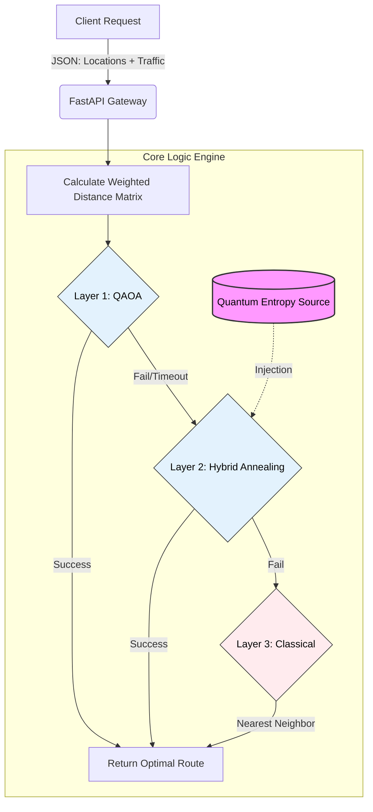

# Entangled Minds: Quantum-Hybrid Logistics Backend


> **⚠️ Note to Reviewers:** This repository contains the **Core Backend Logic & Quantum Solvers**.
> * **Frontend / UI Repository:** [https://github.com/saishmungase/Entangled-Minds]
> * **Live Demo:** [https://entangled-minds-qc.vercel.app/]

## ⚡ Project Overview
**Entangled Minds** is a high-performance logistics engine designed to solve the **Vehicle Routing Problem (VRP)**. It utilizes a **Hybrid Quantum-Classical Architecture** to optimize delivery routes, specifically designed to handle high-complexity scenarios where classical heuristics often get stuck in local optima.

## 🏗 System Architecture & Logic Flow

The backend operates on a **3-Layer Failover Strategy**. It prioritizes quantum precision but ensures 100% reliability through classical fallback mechanisms.



## 🔧 Key Technical Features

### 1. Quantum Entropy Injection (Layer 2)
Unlike standard Simulated Annealing which uses pseudo-random numbers, this engine utilizes Qiskit Aer to generate true quantum randomness.

**Mechanism:** A quantum circuit places a qubit in superposition (H-gate) and measures it.

**Benefit:** This simulates "Quantum Tunneling," allowing the algorithm to escape local minima in the energy landscape more effectively than classical random walks.

### 2. Fleet Balance Cost Function
The solver optimizes not just for distance, but for workload equity across the fleet to prevent resource exhaustion.

$$\text{Cost} = \sum(\text{Distance}) + (\alpha \times \sigma_{\text{routes}})$$

Where:
- $\sum(\text{Distance})$: Total kilometers traveled by all vehicles
- $\sigma_{\text{routes}}$: Standard deviation of distances (imbalance metric)
- $\alpha$: Penalty weight (set to 50.0 in current config)

### 3. Dynamic Traffic Simulation
The system calculates a dynamic adjacency matrix based on the traffic_intensity parameter:

- **Normal:** Standard Euclidean distance
- **Heavy:** Probabilistic edge-weight penalties applied to simulate jams

## 💻 Tech Stack
- **Language:** Python 3.9+
- **API Framework:** FastAPI
- **Quantum SDK:** Qiskit / Qiskit Aer / Qiskit Algorithms
- **Data Processing:** NumPy

## 📡 API Reference

### POST /api/optimize

**Payload:**
```json
{
  "locations": [
    {"id": "1", "name": "Depot", "lat": 12.97, "lng": 77.59},
    {"id": "2", "name": "Drop A", "lat": 12.95, "lng": 77.60}
  ],
  "num_vehicles": 2,
  "traffic_intensity": "normal"
}
```

**Response:**
```json
{
  "solution_method": "Layer 2: Quantum-Enhanced Annealing",
  "is_quantum": true,
  "execution_time": 0.45,
  "balance_metric": 1.2,
  "routes": [...]
}
```

## 🚀 Setup & Installation

### Clone the Repository
```bash
git clone https://github.com/yourusername/quantum-route-optimizer.git
cd quantum-route-optimizer
```

### Install Dependencies
```bash
pip install fastapi uvicorn qiskit qiskit-aer qiskit-algorithms qiskit-optimization numpy
```

### Run the Server
```bash
python main.py
# Server running at http://0.0.0.0:8000
```

